

  <a href="https://admingod.ch"><picture><source media="(prefers-color-scheme: dark)" srcset="assets/cards/header-dark.svg" />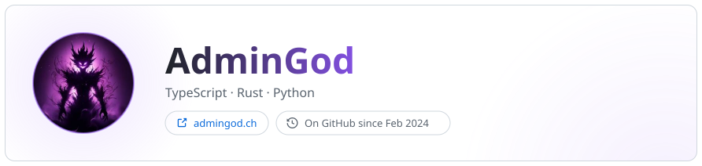</picture></a>
  <picture><source media="(prefers-color-scheme: dark)" srcset="assets/cards/overview-dark.svg" />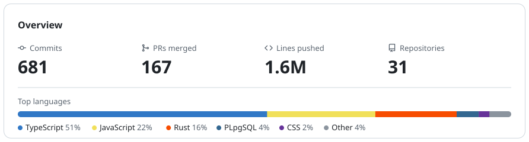</picture>
  <picture><source media="(prefers-color-scheme: dark)" srcset="assets/cards/stack-dark.svg" />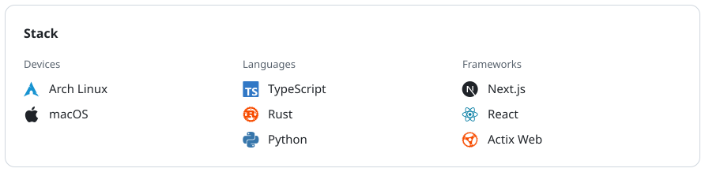</picture>

<h3 align="center">Projects</h3>

<!-- PROJECTS:START -->

  <a href="https://github.com/AdminGodZ/AdminSearch"><picture><source media="(prefers-color-scheme: dark)" srcset="assets/projects/AdminSearch-dark.svg" />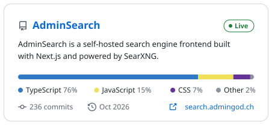</picture></a><a href="https://github.com/AdminGodZ/Aeralyth"><picture><source media="(prefers-color-scheme: dark)" srcset="assets/projects/Aeralyth-dark.svg" />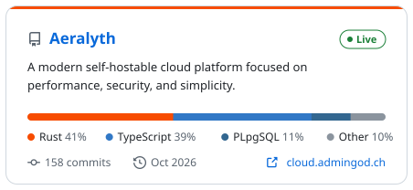</picture></a>
  <a href="https://github.com/AdminGodZ/The-Game"><picture><source media="(prefers-color-scheme: dark)" srcset="assets/projects/The-Game-dark.svg" />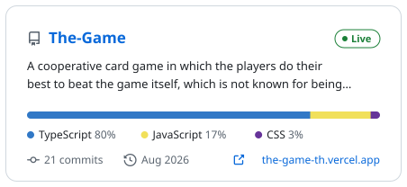</picture></a><a href="https://github.com/AdminGodZ/bbw-m426-kiss"><picture><source media="(prefers-color-scheme: dark)" srcset="assets/projects/bbw-m426-kiss-dark.svg" />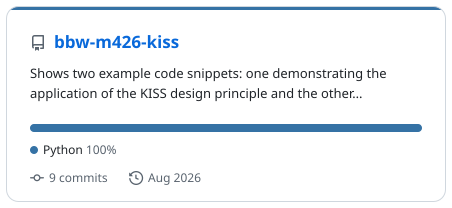</picture></a>
  <a href="https://github.com/AdminGodZ/bbw-m122-ad-script"><picture><source media="(prefers-color-scheme: dark)" srcset="assets/projects/bbw-m122-ad-script-dark.svg" />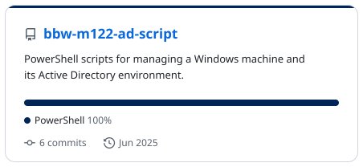</picture></a><a href="https://github.com/AdminGodZ/bbw-m165"><picture><source media="(prefers-color-scheme: dark)" srcset="assets/projects/bbw-m165-dark.svg" />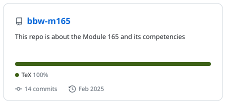</picture></a>
  <a href="https://github.com/AdminGodZ/bbw-m346"><picture><source media="(prefers-color-scheme: dark)" srcset="assets/projects/bbw-m346-dark.svg" />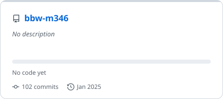</picture></a><a href="https://github.com/AdminGodZ/bbw-trips_project_react"><picture><source media="(prefers-color-scheme: dark)" srcset="assets/projects/bbw-trips_project_react-dark.svg" />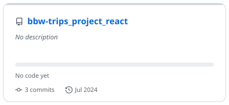</picture></a>
  <a href="https://github.com/AdminGodZ/bbw-ReactGamingShop"><picture><source media="(prefers-color-scheme: dark)" srcset="assets/projects/bbw-ReactGamingShop-dark.svg" />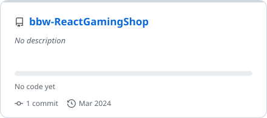</picture></a>

<!-- PROJECTS:END -->
